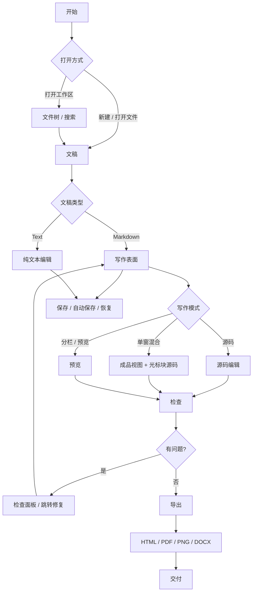

# Prism 写作心流：三版技术方案与产品收束（2026-11-19）

> 已确认前提：**写作心流优先、Typora 式混合、快速追平、能力清单供内部决策**。  
> 本文取代 `prism-typora-gap-technical-plan-2026-11-18.md` 的“五项平均推进”结论。  
> 配套：`docs/prism-capabilities.md`（能力地图与自动附录）。

---

## 1. 先修正问题定义

### 1.1 上一版错在哪

| 表象 | 真正原因 |
| --- | --- |
| 能力清单不够完善 | 把 154 个命令当能力，缺少用户任务、证据、成熟度、取舍；手工清单必然腐烂 |
| 技术方案不够安全/高效/简洁 | 解决方案先行：先加模块，再补威胁模型、性能预算、回滚策略 |
| 五项差距平均推进 | 把竞品功能表当成需求，没有判断哪些是手段、哪些是结果 |
| 单视图 WYSIWYG 被当成一个功能 | 真正要解决的是“写作时不要在源码和结果之间来回切换” |

### 1.2 底层需求

用户要的不是“更多功能”，而是：

**打开文稿后，写作过程不被打断；写出来的东西，预览可信、导出可交付。**

这条链路里最贵的摩擦是：

1. 写一段 → 切预览看效果 → 切回源码改 → 再切预览；
2. 插图后不知道最终版式；
3. 导出 PDF/Word 后才发现图片、分页、书签不对；
4. 想微调外观，却要学主题包结构；
5. 想看进度，却只有字数。

### 1.3 手段 vs 目标

| 用户提出的手段 | 判断 | 真正的目标 | 更优解 |
| --- | --- | --- | --- |
| 完整 WYSIWYG | 手段，且过度 | 减少模式切换 | Typora 式单窗混合编辑；复杂块回源码 |
| 更多导入格式 | 手段 | 降低迁移成本 | 先做 HTML/DOCX；其他用 Pandoc 外挂 |
| 自定义 CSS | 手段 | 个性化外观 | 先做字体/行宽/强调色等 token 控件；CSS 作为高级出口 |
| 统计维度 | 手段，低差异 | 进度感/交付预估 | 先暴露阅读时间与段落进度，不扩状态栏 |
| PDF 书签 | 结果型需求 | 导出物可导航、可交付 | 优先做，风险低、价值明确 |

### 1.4 更值得先解决的问题

1. **能力真相层**：能力地图 + 自动附录，解决文档腐烂。
2. **写作心流的单窗闭环**：不是完整 WYSIWYG，而是“成品视图 + 光标块源码”。
3. **导出可信**：PDF 书签、图片尺寸、预览/导出一致性。
4. **支持成本控制**：不开放无边界的格式与 CSS。

---

## 2. 三版方案

三版不是“功能多少”的差别，而是**编辑引擎与文档管线的根本选择**。

### 方案 A：单窗编辑层（Single-Pane Editing Layer）

**一句话：保留 CodeMirror 作为唯一编辑器，在渲染视图上叠加“块内编辑”，用最小改动实现 Typora 式混合。**

#### 架构

```text
CodeMirror doc（唯一真源）
  → markdownRenderService（existing）
  → RenderedBlock[] + source map
  → LivePreviewPane
      ├─ 渲染块（只读，成品外观）
      └─ BlockEditorOverlay（当前块挂载轻量编辑器）
  → 提交：CodeMirror transaction
```

#### 范围

- 新增 `live` 视图态：单窗混合编辑。
- 光标所在块显示 Markdown 源码，其余块呈现成品。
- 表格、代码、公式、图表等复杂块默认只读；双击回源码块。
- 复用现有命令、撤销、搜索、诊断、导出。
- 图片尺寸：先做拖拽缩放 + 统一尺寸属性。
- PDF 书签：独立小项，优先交付。
- 外观：token 控件优先，原始 CSS 暂缓。
- 统计：按需浮层，不做状态栏常驻。
- 导入：HTML/DOCX 延后，不阻塞主链路。

#### 优点

- 最快形成用户可见价值。
- 不引入第二编辑器，不破坏源码真源。
- 撤销、搜索、诊断、导出全部复用，测试面可控。
- 安全边界基本不变。

#### 缺点

- 不是“完全隐藏标记”的 WYSIWYG；复杂块仍会看到源码。
- 块边界、IME、跨块选择、嵌套列表是硬骨头。
- 用户预期需要明确管理，否则会被认为“假的所见即所得”。

#### 适用

快速追平、写作心流优先、现有 Markdown 用户为主。

---

### 方案 B：双引擎富文本（Dual Engine）

**一句话：源码模式继续用 CodeMirror，单窗模式换成 ProseMirror/Tiptap，Markdown 只作为导入导出格式。**

#### 架构

```text
Markdown ⇄ Document Model (ProseMirror JSON)
  ├─ Source Mode: CodeMirror
  └─ Rich Mode: ProseMirror/Tiptap
共享：命令适配层、导出渲染、诊断适配
```

#### 范围

- 真正的富文本单视图，标记完全隐藏。
- 图片拖拽、缩放、对齐在富文本层原生实现。
- 自定义 CSS 可以直接作用于富文本 DOM。
- 导入格式更容易接 DOCX/HTML（转 Document Model）。
- 统计可从 Document Model 直接算。

#### 优点

- 对非 Markdown 用户最友好，接近 Word/Notion。
- 富文本交互成熟，图片/表格/选区手感好。
- 长期看，导入/导出/编辑器可以围绕统一 Document Model 扩展。

#### 缺点

- **Markdown 往返有损**：注释、原始 HTML、复杂表格、front matter、图表源码都可能丢失或被重写。
- 两套编辑器、两套命令、两套诊断、两套测试；维护成本接近翻倍。
- 搜索、撤销、源码定位、导出保真全部要重新验证。
- 新增 ProseMirror/Tiptap 依赖与较大的包体。
- 可能把 Prism 从“源码可信的写作器”推向“富文本编辑器”，改变用户群与品牌。

#### 适用

目标用户明显偏向 Word/Notion 迁移用户，且愿意接受 Markdown 不再是唯一真源。

---

### 方案 C：文档管线平台（Document Pipeline Platform）

**一句话：把 Markdown AST、source map、渲染器、编辑器、导入/导出适配器抽成统一管线，先接 CodeMirror 块编辑，后续可替换 ProseMirror。**

#### 架构

```text
DocumentPipeline
  ├─ Parser: Markdown → AST + source map
  ├─ Transformer: Prism extensions (callout/math/diagram/image size)
  ├─ Renderer: preview / export / live
  ├─ EditorAdapter: CodeMirror block editor（先） / ProseMirror（后）
  ├─ ImportAdapter: html / docx / epub
  └─ ExportAdapter: html / pdf / png / docx
```

#### 范围

- 五项全做，且为未来格式/编辑器留接口。
- 统一 RenderMetadata、RenderOptions、source map。
- 导入/导出/编辑都围绕同一 AST 契约。
- 能力清单可由管线元数据自动生成更多部分。

#### 优点

- 长期扩展性最好；新增格式、编辑器、导出的边际成本最低。
- 预览/导出一致性有架构保证。
- 可以渐进替换编辑器，不必一次性重写。

#### 缺点

- 最慢见到用户价值；抽象成本高。
- 五项需求不足以证明平台必要，容易过度设计。
- 需要更强的测试、ADR、迁移与团队约束，否则会变成“漂亮的空架子”。

#### 适用

Prism 明确要走多格式、多编辑器、平台化路线，且愿意用更长周期换长期扩展性。

---

## 3. 方案对比

| 维度 | A 单窗编辑层 | B 双引擎 | C 文档管线平台 |
| --- | --- | --- | --- |
| 首次用户价值 | 最快 | 中等 | 最慢 |
| 写作心流 | 高（Typora 式） | 最高（完全富文本） | 高（可渐进） |
| 源码可信 | 最高 | 风险高 | 高 |
| 导出一致性 | 高（复用现有管线） | 需重建 | 最高（架构保证） |
| 安全面 | 低变化 | 高（contenteditable/粘贴） | 中（边界多） |
| 性能风险 | 中（块渲染/IME） | 高（双引擎） | 中高（抽象层） |
| 维护成本 | 中 | 最高 | 高 |
| 扩展性 | 中 | 中高 | 最高 |
| 依赖新增 | 无 | ProseMirror/Tiptap | 视实现 |
| 适合 | 快速追平 | 用户群转向 | 长期平台 |

### 3.1 五项能力在三版中的覆盖

| 能力 | A 单窗编辑层 | B 双引擎 | C 文档管线平台 |
| --- | --- | --- | --- |
| 单窗混合编辑 | 核心；CodeMirror 块编辑 | 原生富文本；体验最好 | 先 CodeMirror，后 ProseMirror |
| 图片尺寸 | 统一属性 + 手柄 | 富文本原生拖拽 | 管线统一尺寸节点 |
| 导入格式 | 延后，先 HTML/DOCX | 较容易接 Document Model | adapter 体系，最完整 |
| 自定义 CSS | token 控件优先，CSS 暂缓 | 直接作用于富文本 | 统一样式管线 |
| 统计 | 按需浮层 | 从 Document Model 算 | 管线元数据 |
| 能力清单 | 已完成能力地图 + 自动附录 | 同 A | 可由管线元数据扩展 |

### 推荐：A+，而不是纯 A

**A+ = 方案 A 的编辑层 + 方案 C 的两个契约：**

1. **RenderMetadata / source map**：块编辑、图片尺寸、PDF 书签、统计共用。
2. **能力清单自动附录**：防止文档腐烂。

不引入 C 的完整平台抽象，不引入 B 的第二编辑器。理由：

- 已确认“Typora 式混合”，不是“完全隐藏标记”；
- 已确认“写作心流优先”，A 最快触及核心摩擦；
- 已确认“快速追平”，B 的重写周期与之冲突；
- A+ 保留未来升级到 C 的接口，但不提前支付平台税。

---

## 4. 二阶、三阶影响

### 4.1 方案 A

| 层级 | 影响 |
| --- | --- |
| 直接 | 单窗写作减少切换；块编辑需要新的交互与状态 |
| 二阶 | 用户会期待“所有块都能富文本编辑”；复杂块回源码可能被视为缺陷 |
| 三阶 | 若块边界处理不好，会出现“看起来像 WYSIWYG，但经常跳回源码”的信任损耗；需要明确产品话术与降级路径 |
| 其他模块 | 搜索、撤销、诊断、导出复用；但 `SplitView`、`ViewModeSwitch`、命令可用性、测试矩阵要改 |
| 维护 | 中等；新增 live domain，但不复制编辑器 |

### 4.2 方案 B

| 层级 | 影响 |
| --- | --- |
| 直接 | 富文本体验最好；导入/图片/表格更自然 |
| 二阶 | Markdown 往返有损，用户可能发现源码被改写；需要“源码锁定”或“只读源码”模式 |
| 三阶 | 产品定位从“Markdown 写作器”滑向“富文本编辑器”；原有高级用户可能流失 |
| 其他模块 | 命令、诊断、搜索、导出、测试全部双份；维护成本长期高 |
| 维护 | 最高；两套编辑器生命周期 |

### 4.3 方案 C

| 层级 | 影响 |
| --- | --- |
| 直接 | 架构统一，五项能力可复用 |
| 二阶 | 抽象先行，短期交付变慢；团队需要理解管线契约 |
| 三阶 | 若平台化成功，后续格式/编辑器成本低；若失败，留下难维护的中间层 |
| 其他模块 | 所有渲染/导出/导入都要迁移，回归面大 |
| 维护 | 高 upfront，低边际 |

### 4.4 五项功能的隐藏成本

| 功能 | 隐藏成本 | 控制方式 |
| --- | --- | --- |
| 单窗混合 | IME、跨块选择、嵌套列表、表格、性能 | 先做块级 spike；复杂块明确回源码 |
| 图片尺寸 | 语法污染、跨工具兼容、DOCX/PDF 一致 | 统一样式属性；golden export |
| 导入 | 安全（zip bomb/XXE/外部资源/宏）、支持矩阵 | 非破坏性 staging；只做 HTML/DOCX |
| 自定义 CSS | 样式逃逸、导出不一致、支持负担 | token 控件优先；CSS 作为高级出口 |
| 统计 | 指标焦虑、状态栏回潮 | 按需浮层；不常驻 |

---

### 4.5 安全威胁模型

| 功能 | 资产/入口 | 主要威胁 | 缓解措施 | 验证 |
| --- | --- | --- | --- | --- |
| 单窗混合 | 文稿内容、粘贴 HTML、块编辑 DOM | XSS、事件处理器注入、DOM 覆盖导致内容丢失 | 不把预览设为 contenteditable；所有提交回 CodeMirror；沿用 `rehypePreviewUrlSafety`；粘贴走现有清洗 | 恶意 HTML fixture、粘贴回归 |
| 图片尺寸 | 本地图片、相对路径、SVG | 路径穿越、超大图片解压炸弹、SVG 脚本 | 限制 MIME/扩展名/字节数/像素数；路径限制在工作区；SVG 默认不进入可执行上下文 | 恶意文件 fixture、大小边界 |
| 文件导入 | HTML/DOCX/EPUB、外部资源 | zip bomb、XXE、宏、外部资源回连、路径穿越 | 非破坏性 staging；大小/解压比限制；不执行宏；不自动抓取远程资源；资源路径规范化 | 恶意 DOCX/HTML 样本 |
| 自定义 CSS | 用户 CSS、导出 worker | 样式逃逸、`url()` 外带、遮罩钓鱼、导出不一致 | 派生主题包 + `validateThemeCss`；禁 `@import`/外部 URL/固定定位/禁用指针；只允许主题令牌 | 安全用例集、导出截图对齐 |
| PDF 书签 | 导出 PDF | 异常 outline 对象导致阅读器崩溃/错页 | 统一 `finalizePdfDocument`；对象数量/层级限制；多阅读器验证 | Preview/Chrome/Acrobat 三端 |

### 4.6 性能预算

以下为设计目标，必须用真实 WebView 基准确认，不以 jsdom 数据代替：

| 场景 | 目标 | 失败处理 |
| --- | --- | --- |
| 进入单窗模式（100KB 文档） | < 300ms | 降级为预览 + 点击编辑 |
| 块提交（普通段落） | < 50ms | 只重渲染当前块，不全文解析 |
| 3MB 文档输入 | 不出现可感知卡顿 | 关闭块级实时渲染，退化为源码/预览 |
| 图片拖拽预览 | 60fps 手感 | 只做 CSS transform，不写源码 |
| 导入 5MB HTML | < 3s | 后台任务 + 进度 + 取消 |
| 统计计算（大文档） | worker 内 < 100ms | 防抖 + 缓存 |

### 4.7 简洁性约束

- 不新增第二编辑器引擎（方案 A）。
- 只做一次 settings v2 迁移，不按功能反复加版本。
- 只引入一个 `RenderMetadata/source map` 契约，不建“平台层”。
- 新增命令不超过 3 个：`liveMode`、`showDocumentStatistics`、`importDocument`。
- 不新增状态栏常驻指标。
- 新依赖必须证明不可替代；优先复用现有 mermaid/katex/pdf-lib/turndown。

## 5. 跨领域参照

| 领域 | 类似问题 | 对 Prism 的启示 |
| --- | --- | --- |
| 数据库 | 物化视图不能直接写，必须回基表 | 预览是物化视图；编辑必须回 CodeMirror 真源（A） |
| 编译器 | 富文本编辑需要 source map | 块编辑必须有源码位置映射，否则无法可靠回写 |
| 航空业 | MEL 最低设备清单 | 能力清单应记录“可用状态 + 限制 + 放行条件”，不是功能目录 |
| 制造业 | BOM 物料清单 | 能力地图 + 自动附录 = 人工决策层 + 机器明细层 |
| ETL | staging → validate → transform → commit | 导入必须非破坏性、可诊断、可回滚 |
| 浏览器 | 用户样式强但支持成本高 | 自定义 CSS 应是高级出口，默认给 token 控件 |
| PDF/UA | 书签是导航契约 | PDF 书签优先级应高于“更多导入格式” |
| 健身应用 | 指标过多会干扰行为 | 统计只展示能指导行动的信息 |

---

## 6. 反方论证：假设 A 是错的

### 6.1 最强反对意见

> A 不是真正的所见即所得。用户仍然会看到 Markdown，复杂块还会跳回源码；你花了接近 B 的成本，却只得到一个“半成品”。不如直接上 ProseMirror，体验一步到位。

### 6.2 支持反对意见的证据

- Typora 本身的混合模式仍有大量边界情况；Prism 的表格、公式、图表比 Typora 更复杂。
- 块编辑在 IME 中文输入、跨块选择、嵌套列表、表格单元格上容易出问题。
- 用户对“所见即所得”的预期通常是“完全看不到标记”，A 可能不满足。

### 6.3 反反驳

- 已确认验收标准是 **Typora 式混合**，不是完全隐藏标记；A 与验收标准一致。
- B 的 Markdown 往返有损，会破坏 Prism 的“源码可信”差异；这不是体验升级，而是产品定位改变。
- A 可以先用 spike 验证最危险的 5 个场景；如果失败，再考虑 B 或 C，而不是先重写。
- A 的块编辑可以逐步增强；复杂块回源码是明确的产品契约，不是隐藏缺陷。

### 6.4 重新评估后的结论

**A+ 仍然是最优解，但必须加三道闸门：**

1. **Spike 闸门**：中文 IME、跨块选择、嵌套列表、表格、3MB 文档，五项全过才进入正式实现。
2. **验收闸门**：以“模式切换次数、写作中断次数、块编辑回退率”衡量，不以“看起来像 Typora”衡量。
3. **退出闸门**：如果块编辑回退率长期高于设定阈值，停止加码，转向 B 或 C，不混合两套引擎硬撑。

---

## 7. 产品经理视角：核心功能收束

### 7.1 收束原则

1. **一条主链路**：打开 → 写 → 检查 → 导出。
2. **一个主表面**：写作表面；源码、单窗、分栏、预览是同一文档的不同呈现，不是四个产品。
3. **一个主入口**：导出、设置、检查都从菜单进入；状态区只做反馈。
4. **默认简单， advanced 可选**：图片尺寸、CSS、统计都不出现在首屏。
5. **不新增支持矩阵**：导入格式、CSS 能力必须有明确“不做”清单。

### 7.2 核心功能架构



### 7.3 功能优先级

| 优先级 | 功能 | 理由 |
| --- | --- | --- |
| P0 | 单窗混合编辑 | 直接解决写作心流 |
| P0 | PDF 书签 + 图片尺寸 | 导出可信，差异化 |
| P1 | 外观 token 控件 | 比原始 CSS 更安全、更高频 |
| P1 | 统计浮层 | 低成本、低风险 |
| P2 | HTML/DOCX 导入 | 有价值，但不阻塞核心闭环 |
| 暂缓 | 原始 CSS、EPUB/OPML/PDF 导入、版本历史 | 支持成本高，需求未验证 |

---

## 8. UX / UI 收束：去掉 AI 味和工程师语言

### 8.1 原则

- **说用户的动作，不说系统的实现**：不要“解析资源”，说“图片找不到”。
- **一句话能说清，就不写两句**：删除解释性副标题、重复提示。
- **默认不展示高级项**：CSS、图片尺寸、统计都放到二级入口。
- **每个空态给下一步**：不是“暂无数据”，而是“点击选择一张图片”。
- **错误给可执行动作**：不是“导出失败”，而是“第 3 页图片缺失，替换后重试”。

### 8.2 文案对照

| 现在/方案中的说法 | 改为 | 原因 |
| --- | --- | --- |
| 文档诊断 | 检查文稿 | “诊断”是医生语言，用户想的是“检查” |
| 排版建议 | 排版检查 | “建议”太软，用户不知道要不要处理 |
| Front Matter 属性 | 文稿信息 | 用户不需要知道 YAML 术语 |
| 关系图谱 | 文稿关系 | “图谱”偏技术，且容易误解为知识库 |
| 自定义 CSS | 自定义样式 | 非开发者不知道 CSS 是什么 |
| 导出预检 | 导出前检查 | “预检”是流程术语 |
| 按上次设置导出 | 用上次设置导出 | 动词开头，更像动作 |
| 覆盖上次导出 | 替换上次文件 | 说清楚结果，不说实现 |
| Markdown 参考 | Markdown 速查 | “参考”像手册，“速查”像工具 |
| 迁移指南 | 从其他工具迁移 | 说清场景 |
| 暂无数据 | 还没有内容，先写一段 | 给下一步 |
| 资源解析失败 | 图片没找到，路径可能变了 | 说人话，给原因 |

### 8.3 交互收束

| 场景 | 现在 | 改为 |
| --- | --- | --- |
| 导出 | 多个菜单项、设置分散 | 一个“导出”主入口，格式与设置在一处 |
| 图片 | 插入后无法调大小 | 选中图片出现手柄，拖动即改，源码可读 |
| 外观 | 主题包 + 设置分区 | 常用项（字体/字号/行宽/强调色）在前，高级样式折叠 |
| 统计 | 只有字数 | 悬停看摘要，菜单看详情，不常驻 |
| 检查 | 诊断面板术语多 | 按“链接/图片/排版/导出”分组，点条目直达 |
| 单窗 | 需切视图 | `Cmd+4` 进入，光标块自动显源码，Esc 退出 |

### 8.4 可交付标准

- 首屏没有解释性长文；每个入口一个动词。
- 所有错误都有“发生了什么 + 下一步”。
- 所有空态都有可点击动作。
- 浅色/深色、中/英/日、14/20 字号无溢出。
- 键盘可达，焦点可见，Esc 可退出浮层。
- 不新增状态栏常驻指标。
- 不在首屏暴露 CSS、Front Matter、诊断分类等高级概念。

---

## 9. 决策建议

**选 A+。** 具体顺序：

1. 能力地图与自动附录（已完成）。
2. 单窗块编辑 spike：只验证 5 个高风险场景，不写正式 UI。
3. PDF 书签 + 图片尺寸：独立小项，先交付导出可信。
4. 单窗编辑正式实现：`live` 视图 + 块内编辑 + 复杂块回源码。
5. 外观 token 控件 + 统计浮层。
6. 视数据再决定 HTML/DOCX 导入与原始 CSS。

**不选 B 的理由**：它会改变 Prism 的“源码可信”定位，并且与快速追平冲突。  
**不选 C 的理由**：五项需求不足以证明平台税；只借它的 source map 契约，不借它的全套抽象。

如果后续出现以下信号，再重新评估：

- 单窗块编辑回退率长期高于阈值；
- 大量用户从 Word/Notion 迁入，要求完全隐藏标记；
- 导入格式成为主要获客渠道；
- 主题/自定义样式成为核心付费点（当前开源免费，不适用）。

---

## 10. 完成定义

1. 单窗混合模式在真实 app 中可完成“写一段 → 看效果 → 继续写”，不强制切换视图。
2. 图片尺寸在预览、PDF、PNG、DOCX 中一致。
3. PDF 书签在 macOS Preview / Chrome / Acrobat 中可跳转。
4. 能力地图的 72 项能力有状态、有证据、有决策；命令/设置/格式附录由脚本生成并通过 `capabilities:check`。
5. 所有新增 UI 文案通过三语检查，无工程术语泄漏到首屏。
6. 质量门禁：`npx tsc --noEmit`、相关 `vitest`、`npm run build`、涉及打包时 `npm run macos:build-smoke`。
